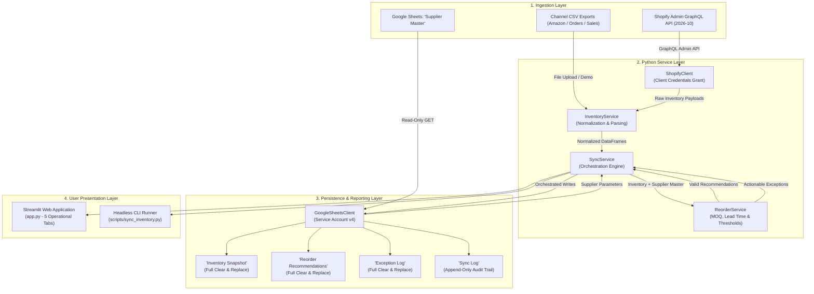

# 🏗️ InventoryOps System Architecture & Technical Design

This document details the software architecture, data pipelines, authentication mechanisms, operational boundaries, and data-quality controls implemented in the **InventoryOps Dashboard** (Helfen Operations Hub).

---

## 1. System Overview & End-to-End Data Flow

The platform connects e-commerce store inventory with human-maintained supplier rules and publishes deterministic planning records and audit logs to Google Sheets and an interactive Streamlit UI.

---

## 2. Authentication & Authorization

### A. Shopify Admin API (GraphQL)
- **Grant Type:** Client Credentials Grant (standard for Shopify custom apps).
- **Endpoint:** `POST https://{SHOPIFY_STORE_DOMAIN}/admin/oauth/access_token`
- **Exchange:** Client ID and Client Secret are exchanged for an ephemeral Admin API access token.
- **Token Management:** The token is cached in-memory on the `ShopifyClient` instance for subsequent API calls and refreshed dynamically if expired.
- **Principle of Least Privilege:** Strictly configured with read-only scopes:
  - `read_products`: Required to query product catalog nodes and variant details.
  - `read_inventory`: Required to query inventory levels across store locations.
  - *No write scopes (`write_products`, `write_inventory`, `write_orders`) are requested or granted.*

### B. Google Sheets API v4
- **Mechanism:** Google Cloud Service Account with OAuth 2.0 JSON private key.
- **Scope:** `https://www.googleapis.com/auth/spreadsheets`
- **Authorization Boundary:** Access is restricted entirely by Google Drive sharing permissions. The Service Account email (e.g. `helfen-sheets-sa@...iam.gserviceaccount.com`) is granted **Editor** permissions specifically on the target Google Sheet (`GOOGLE_SHEET_ID`), granting zero access to any other files in the Google Cloud project.

### C. Secret Isolation & Zero-Leakage Guarantee
- Credentials are read exclusively from environment variables via `python-dotenv`.
- All client exception handlers intercept lower-level HTTP/SDK errors and return sanitized exception messages (`ShopifyAPIError`, `GoogleSheetsAPIError`), preventing API keys, client secrets, or private keys from appearing in logs, terminal outputs, or UI tracebacks.
- `.gitignore` strictly ignores `.env`, `*.json` (with exceptions for project manifests), and `.streamlit/secrets.toml`.

---

## 3. Query Design, Pagination & Resilience

### A. Shopify GraphQL Admin API
- **API Version:** `2026-10`
- **Cursor-Based Pagination:** Queries variants in pages of 50 using `pageInfo { hasNextPage, endCursor }`. Subsequent queries supply the `after: $cursor` parameter until `hasNextPage` is false.
- **Location Parsing:** Location inventories are queried using `inventoryItem { inventoryLevels(first: 10) { edges { node { location { id }, quantities(names: ["available"]) { name, quantity } } } } }`. By referencing `location.id`, the client avoids requiring the privileged `read_locations` access scope while providing accurate location-specific inventory.

### B. Resilience & Rate Limiting
- HTTP network requests in `ShopifyClient` execute with a default 15-second timeout.
- Shopify API cost thresholds and rate limits are managed via deterministic batch sizes (50 variants per request).
- Google Sheets batch updates consolidate row payloads into single HTTP requests (`values().update` and `values().append`), minimizing API quota consumption.

---

## 4. Deterministic Synchronization & Data-Quality Controls

A common failure mode in operational automation is **stale row persistence**—where a subsequent sync with fewer records leaves ghost rows from a previous larger sync. InventoryOps implements strict architectural guards to prevent this:

### A. Full-Grid Tab Replacement
When writing to `Inventory Snapshot`, `Reorder Recommendations`, and `Exception Log`:
1. `service.spreadsheets().values().clear(spreadsheetId=..., range=f"'{TAB_NAME}'")` is executed first.
   - Using the bare sheet name without cell bounds (e.g. `'Reorder Recommendations'`) instructs Google Sheets API v4 to **clear the entire grid** of that tab.
2. `service.spreadsheets().values().update(spreadsheetId=..., range=f"'{TAB_NAME}'!A1", body={"values": [headers] + data_rows})` writes the updated dataset starting at cell `A1`.
3. If an output dataset is empty (such as 0 operational exceptions), the tab is cleared and updated with the header row only. Zero ghost rows remain.

### B. Write Sequence & Boundary Preservation
Sync operations in `SyncService.run_sync()` enforce an exact write sequence:
1. `write_inventory_snapshot()` (clears & replaces `Inventory Snapshot`)
2. `write_reorder_recommendations()` (clears & replaces `Reorder Recommendations`)
3. `write_exception_log()` (clears & replaces `Exception Log`)
4. `append_sync_log()` (appends a single record to `Sync Log`)

**Protected Boundaries:**
- **`Supplier Master` is never touched by write operations:** It is strictly a human-managed rule repository containing vendor lead times, minimum order quantities, and target stock levels.
- **`Sync Log` is append-only:** Uses `insertDataOption="INSERT_ROWS"` and `range=f"'{TAB_SYNC_LOG}'!A:I"`. It is never cleared, creating a permanent audit trail.

### C. Definition of "Records Written" Metric
$$\text{records\_written} = \text{len(inventory\_df)} + \text{len(recommendations\_df)} + \text{len(exceptions\_df)}$$
- Strictly counts **data rows written** across the 3 output tabs.
- Strictly **excludes table headers** (headers are structural metadata, not data rows).
- Strictly **excludes the `Sync Log` row itself**.

---

## 5. Reorder Engine & Operational Logic

The calculation engine in [services/reorder_service.py](file:///Users/faizan/Projects/inventoryops_dashboard/services/reorder_service.py) enforces e-commerce inventory rules:

### A. Metrics & Formulas
1. **Average Daily Sales (ADS):**
   $$\text{ADS} = \frac{\text{units\_sold}}{\text{period\_days}} \quad (\text{default: 30 days})$$
2. **Target Stock Cover:**
   $$\text{target\_stock} = \begin{cases}
   \text{explicit\_target\_stock} & \text{if specified in Supplier Master} \\
   \lceil \text{ADS} \times \text{safety\_days} \rceil & \text{if } \text{ADS} > 0 \\
   \max(\text{lead\_time\_days} \times 2, \text{low\_stock\_threshold} \times 4) & \text{fallback}
   \end{cases}$$
3. **Reorder Point (ROP):**
   $$\text{reorder\_point} = \begin{cases}
   \text{explicit\_threshold} & \text{if specified in Supplier Master} \\
   \lceil \text{ADS} \times \text{lead\_time\_days} \rceil & \text{if } \text{ADS} > 0 \\
   \text{default\_low\_stock\_threshold (5)} & \text{fallback}
   \end{cases}$$
4. **Suggested Reorder Quantity (with MOQ Floor):**
   $$\text{shortfall} = \max(0, \text{target\_stock} - \text{available\_quantity})$$
   $$\text{suggested\_quantity} = \begin{cases}
   \max(\text{shortfall}, \text{MOQ}) & \text{if } \text{shortfall} > 0 \\
   0 & \text{otherwise}
   \end{cases}$$

### B. Urgency Status Classification
- **`Urgent Reorder Required`:** Available stock is zero or negative ($\le 0$).
- **`Reorder Review Needed`:** Available stock is greater than zero but at or below the reorder threshold ($0 < \text{stock} \le \text{ROP}$).
- **`Healthy`:** Available stock is safely above the reorder threshold ($\text{stock} > \text{ROP}$).

### C. Missing-SKU & Exception Routing
- Products lacking a valid SKU identifier cannot be ordered from suppliers.
- These items are **excluded from `Reorder Recommendations`** to prevent polluting purchasing plans.
- They are routed exclusively to `Exception Log` with severity `CRITICAL` and type `Missing SKU`.
- Products with valid SKUs that are not present in `Supplier Master` are preserved in `Reorder Recommendations` with `supplier_name: "Unassigned"`, and flagged in `Exception Log` with severity `WARNING` and type `Missing Supplier Mapping`.

---

## 6. Test Architecture & Coverage

The test suite is built on standard `unittest` and `unittest.mock`. All 39 tests execute offline in under 1 second without credentials or external API calls:

| Test Module | Coverage Scope | Test Count |
| :--- | :--- | :--- |
| [tests/test_shopify_client.py](file:///Users/faizan/Projects/inventoryops_dashboard/tests/test_shopify_client.py) | Client Credentials exchange, token caching, GraphQL pagination, 401/403/500 error sanitization | 8 tests |
| [tests/test_google_sheets_client.py](file:///Users/faizan/Projects/inventoryops_dashboard/tests/test_google_sheets_client.py) | Service Account auth, full-grid clearing, dataset shrinkage, empty exception handling, Supplier Master preservation, append-only Sync Log | 11 tests |
| [tests/test_services.py](file:///Users/faizan/Projects/inventoryops_dashboard/tests/test_services.py) | Inventory normalization, cross-channel reconciliation, sales velocity, MOQ enforcement, missing SKU exclusion, end-to-end sync workflow | 13 tests |
| [tests/test_dashboard.py](file:///Users/faizan/Projects/inventoryops_dashboard/tests/test_dashboard.py) | Streamlit `AppTest` execution across all 5 operational tabs, CSV upload parsing, metric cards | 7 tests |
| **Total** | **Comprehensive unit & integration regression coverage** | **39 tests** |
