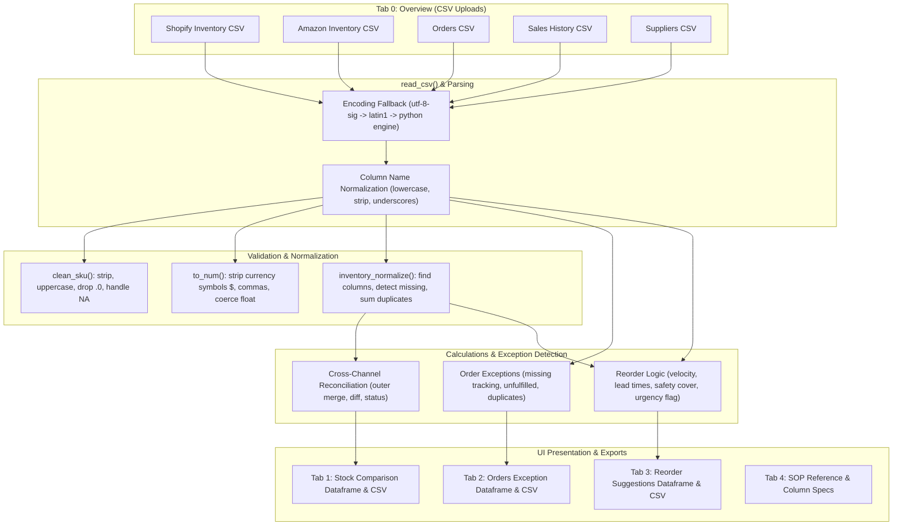

# Helfen Operations Hub — Current State Assessment

**Date of Audit:** October 27, 2026
**Audited Codebase:** `/Users/faizan/Projects/inventoryops_dashboard`
**Application Title:** `📦 InventoryOps: E-commerce Operations Dashboard` (Helfen Operations Hub)

---

## 1. Executive Summary

The current application is a single-file Streamlit prototype (`app.py`, 403 lines) built to reconcile multi-channel e-commerce inventory, flag order fulfillment exceptions, and calculate reorder recommendations.

All operations currently rely on in-memory CSV file uploads or local sample files. There are **no existing API connectors**, **no persistent database**, and **no automated background syncs**.

The code is well-structured for an early prototype, but business logic, data cleaning, and UI rendering are tightly coupled inside `app.py`.

---

## 2. Environment, Git & Dependency Audit

- **Python Version:** `3.12.13`
- **Virtual Environment:** Dedicated `.venv/` exists in project root.
- **Dependencies (`requirements.txt`):**
  - `streamlit>=1.35` (currently installed: `streamlit==1.66.1`)
  - `pandas>=2.0` (currently installed: `pandas==3.1.0`, `numpy==2.5.4`)
- **Git Status:**
  - **Not initialized** (`fatal: not a git repository`).
  - **No `.gitignore` file exists.** (Critical security requirement: must be created immediately to safeguard `.venv/`, `.env`, service account keys, and runtime artifacts).
- **Secrets & Configuration:**
  - No `.env` or `.env.example` files present.
  - No hardcoded secrets found in the codebase.
- **Launch Command:**
  ```bash
  streamlit run app.py
  ```

---

## 3. Analysis of the Five Operational Tasks

The application presents its functionality across five Streamlit tabs (`st.tabs`):

### Task 1: Single-Channel Inventory Normalization & Low-Stock Detection
- **Location:** Tab 1 ("📦 Stock comparison") when only one channel is uploaded.
- **Input:** Single CSV (Shopify or Amazon inventory).
- **Processing:** Normalizes SKU, coerces stock to numeric, aggregates duplicate SKUs by summation, flags rows where `stock <= low_stock_threshold` (sidebar input, default: 5).
- **Output:** Metric cards (Total SKUs, Total Units, Low Stock SKUs), interactive dataframe, and a downloadable normalized CSV (`shopify_inventory_normalized.csv` or `amazon_inventory_normalized.csv`).

### Task 2: Cross-Channel Inventory Reconciliation (Shopify vs. Amazon)
- **Location:** Tab 1 ("📦 Stock comparison") when both Shopify and Amazon CSVs are provided.
- **Input:** Two CSV exports (Shopify inventory + Amazon inventory).
- **Processing:**
  - Outer merge on `sku`.
  - Missing in Amazon (`_merge == "left_only"` -> status `"Missing from Amazon"`).
  - Missing in Shopify (`_merge == "right_only"` -> status `"Missing from Shopify"`).
  - Quantity discrepancy (`shopify_stock != amazon_stock` -> status `"Stock mismatch"`).
  - Low stock warning (`min(shopify, amazon) <= low_stock_threshold` and status is `"Match"` -> status `"Low stock"`).
  - Otherwise status is `"Match"`.
- **Output:** Metrics (SKUs compared, Stock mismatches, Missing records, Low stock), full comparison table, and downloadable report (`stock_comparison.csv`).

### Task 3: Orders & Delivery / Fulfillment Exception Audit
- **Location:** Tab 2 ("🚚 Orders & delivery").
- **Input:** `orders.csv` export.
- **Processing:**
  - Dynamically searches for `order_id`, `tracking_number`, and `fulfillment_status` columns using alias lists.
  - Flags rows where tracking number is missing:
    - If status contains `"unfulfilled"`, `"pending"`, `"processing"`, or `"open"` -> `"Not yet fulfilled"`.
    - If status is fulfilled or omitted -> `"Missing tracking"`.
  - Flags duplicate order rows (multi-item orders or redundant entries):
    - Status updated to `"Duplicate order ID — review"` or appended with `"(Multi-item / duplicate ID)"`.
- **Output:** Metric cards (Total orders/rows, Rows needing review), exception table, and downloadable report (`order_checks.csv`).

### Task 4: Supplier Reorder Recommendations
- **Location:** Tab 3 ("🧾 Supplier reordering").
- **Input:** `sales_history.csv` + optional `suppliers.csv` + optional inventory levels (from sales file or fallback from Tab 1 inventory merge).
- **Processing & Formulas:**
  - Calculates Average Daily Sales:
    $$\text{avg\_daily\_sales} = \frac{\text{units\_sold}}{\text{period\_days}} \quad (\text{default period: 30 days})$$
  - Calculates Target Stock Cover:
    $$\text{target\_stock} = \lceil \text{avg\_daily\_sales} \times \text{safety\_days} \rceil \quad (\text{default safety\_days: 30})$$
  - Calculates Suggested Reorder Quantity:
    $$\text{suggested\_reorder\_qty} = \max(0, \lceil \text{target\_stock} - \text{current\_stock} \rceil)$$
  - Evaluates Reorder Trigger:
    $$\text{reorder\_now} = \text{current\_stock} \le (\text{avg\_daily\_sales} \times \text{supplier\_lead\_time\_days})$$
  - Action assigned: `"Reorder review needed"` if `reorder_now` is True, else `"Monitor"`.
- **Output:** Metric cards (SKUs in sales file, Suggested reorder, Urgent review), interactive recommendations dataframe, and downloadable CSV (`reorder_suggestions.csv`).

### Task 5: Operations Reference, Standard Operating Procedure (SOP) & Data Guide
- **Location:** Tab 4 ("📚 SOP & data guide").
- **Functionality:** Operational user guide detailing supported column aliases, encoding notes (UTF-8, Latin-1, BOM), duplicate handling rules, and code snippets demonstrating sample CSV schemas.

---

## 4. Data Flow and Processing Pipeline



---

## 5. Column Aliases and Supported Schemas

The application provides fuzzy header matching via `find_col(df, candidates)`:

| Domain | Canonical Field | Recognised Aliases in Current Code |
| :--- | :--- | :--- |
| **Inventory** | `sku` | `sku`, `variant_sku`, `seller_sku`, `product_sku`, `item_sku`, `item_number`, `part_number`, `barcode`, `asin` |
| **Inventory** | `quantity` | `stock`, `quantity`, `available`, `available_quantity`, `inventory`, `qty`, `units`, `on_hand`, `quantity_on_hand`, `afn_fulfillable_quantity`, `fulfillable_quantity`, `variant_inventory_qty`, `total_quantity`, `current_stock` |
| **Orders** | `order_id` | `order_id`, `order_number`, `order_no`, `order`, `order_name`, `name`, `id`, `amazon_order_id`, `merchant_order_id`, `sales_order_number`, `order_reference`, `invoice_no` |
| **Orders** | `tracking_number`| `tracking_number`, `tracking`, `tracking_id`, `tracking_code`, `tracking_no`, `tracking_url`, `carrier_tracking`, `waybill`, `tracking_num`, `shipment_tracking_number` |
| **Orders** | `fulfillment_status`| `fulfillment_status`, `fulfilment_status`, `order_status`, `status`, `shipping_status`, `delivery_status`, `shipment_status`, `state` |
| **Sales** | `units_sold` | `units_sold`, `quantity_sold`, `units`, `sales_units`, `qty_sold`, `qty`, `sales`, `sold`, `quantity` |
| **Sales** | `period_days` | `period_days`, `days`, `days_covered`, `lookback_days`, `period`, `duration_days` |
| **Suppliers** | `lead_time_days`| `lead_time_days`, `lead_days`, `lead_time`, `leadtime`, `supplier_lead_time` |

---

## 6. Existing Tests

- **Test Suite Location:** `tests/test_dashboard.py` (uses Streamlit `AppTest` framework).
- **Test Coverage:**
  1. `test_initial_load_no_errors`: Validates initial page rendering without exceptions.
  2. `test_single_amazon_upload_no_false_errors`: Verifies single upload behavior.
  3. `test_single_shopify_upload_no_false_errors`: Verifies single upload behavior.
  4. `test_both_inventory_comparison`: Uploads both files, verifies `Stock mismatch`, `Missing from Shopify`, `Missing from Amazon`.
  5. `test_orders_exceptions`: Checks missing tracking, unfulfilled, and duplicate warnings.
  6. `test_sales_and_suppliers_suggestions`: Validates reorder calculation outputs.
  7. `test_invalid_csv_handled_gracefully`: Checks missing column warnings.
- **Audit Finding:** All tests pass functionally; however, when executing sequentially on cold runs, `AppTest` timeout needs sensible configuration to prevent sporadic cold-start timeouts.

---

## 7. Gaps & Changes Required for Real API Integration

1. **Version Control & Secret Protection:**
   - Initialize Git repository and create a bulletproof `.gitignore` protecting `.env`, `*.json` credentials, `.venv/`, and temp logs.
   - Create `.env.example` as a template for Shopify and Google credentials.
2. **Data Source Selector:**
   - Currently, the app only responds to file uploaders. We need a selector: `Demo Data`, `Upload CSV`, `Shopify API`, `Shopify + Google Sheets`.
   - The app must continue running seamlessly in Demo and CSV modes without requiring API credentials.
3. **Decoupled Architecture:**
   - Extract API connectors (`integrations/shopify_client.py`, `integrations/google_sheets_client.py`).
   - Extract data normalization and domain calculations (`services/inventory_service.py`, `services/reorder_service.py`, `services/sync_service.py`).
   - Maintain pure unit tests with mocked API fixtures so no external network access is needed for automated tests.
4. **Authoritative Data Boundaries:**
   - Shopify Admin GraphQL API is authoritative for products, variants, SKUs, inventory locations, and available inventory.
   - Google Sheets is authoritative for human-managed supplier metadata (MOQs, lead times, target stock overrides) and holds synced operational reports/snapshots.
